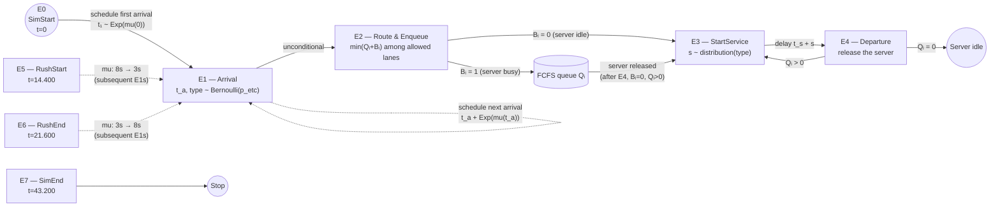

# Event Graph — Project 14: Highway Toll Plaza with Mixed Payment Lanes

This document defines the **discrete-event** design of the toll plaza system
in SENG-331 Project 14: system state variables, events, conditional and
unconditional transitions between events, and their counterparts in
`simulation.py`.

---

## 1. System Entities

| Entity | Count (default) | Description |
|---|---|---|
| Manual booth (`M1..M3`) | 3 | Serves vehicles paying by cash/card. Service time ~ Triangular(8, 14, 25) s. |
| ETC pass-through point (`E1..E2`) | 2 | Serves OGS/HGS-tagged vehicles. Service time ~ Uniform(2, 4) s. |
| Hybrid lane (`H1..`) | 0 (optional) | Serves both vehicle types; the service distribution is selected by vehicle type. |
| Vehicle | — | Classified as ETC / manual at arrival via Bernoulli(p_etc). |

Each lane has an **independent FCFS queue**; there is no jockeying between
queues.

---

## 2. State Variables

| Variable | Meaning |
|---|---|
| `t` | Simulation clock (s) |
| `mu(t)` | Mean inter-arrival time: 3 s during the rush period, 8 s otherwise. Arrival rate `rho(t) = 1/mu(t)`. |
| `rush` | Rush period flag: `rush_start <= t < rush_end` |
| `N` | Counter of generated vehicles (unique vehicle ID) |
| `Q_i` | Queue length of lane *i* (vehicles waiting) |
| `B_i` | Number of busy servers at lane *i* (0 or 1 for capacity=1) |
| `U_i = Q_i + B_i` | Total length of lane *i* — the basis of the routing decision |
| `type` | Vehicle type: `etc` or `manual` |
| `t_a, t_q, t_s, t_d` | Per-vehicle arrival, queue entry, service start and departure times |
| `s` | Sampled service time |

---

## 3. Events

| Code | Event | Scheduled by | Timing / Condition |
|---|---|---|---|
| **E0** | `SimStart` | External (engine) | `t = 0`. Schedules the first E1 and the E5/E6/E7 markers. |
| **E1** | `Arrival` | Previous E1 or E0 | `Exponential(mu(t))` after the previous arrival. Also determines the type: `Bernoulli(p_etc)`. |
| **E2** | `Route & Enqueue` | Immediately after E1 (unconditional) | Among the allowed lanes, the one with `min(U_i)` is selected; on a tie, the first eligible lane. The vehicle joins the selected lane's FCFS queue. |
| **E3** | `StartService` | E2 (if the lane is idle) or E4 (if the queue is non-empty) | Condition: `B_i = 0` and `Q_i > 0`. `s` is sampled from the distribution. |
| **E4** | `Departure` | E3 | At `t_s + s`; the server is released. |
| **E5** | `RushStart` | E0 (scheduled) | `t = 14,400` (4th hour). Subsequent arrivals use `mu = 3 s`. |
| **E6** | `RushEnd` | E0 (scheduled) | `t = 21,600` (6th hour). Subsequent arrivals use `mu = 8 s`. |
| **E7** | `SimEnd` | E0 (scheduled) | `t = 43,200` (12th hour). The simulation stops; remaining vehicles get `completed = False`. |

---

## 4. Event Graph



### Transition explanations

* **E0 → E1**: At the start of the simulation, the first arrival time `t₁`
  is sampled as `Exp(mu(0))`. The E5/E6/E7 marker events are scheduled at
  fixed times.
* **E1 → E1 (self-scheduling)**: The arrival process schedules the next
  arrival according to the current mean inter-arrival time. Because the rate
  is piecewise constant, if a sample crosses a piece boundary, the clock
  jumps to the boundary and a new sample is drawn at the new rate — this is
  **statistically exact** thanks to the memoryless property of the
  exponential distribution (`arrivals.py` → `_arrival_times_piecewise`).
* **E1 → E2**: At arrival, the vehicle type is determined by Bernoulli;
  then the lane with the **smallest total length** within the allowed lane
  group is selected (`ETC`: ETC+hybrid; `manual`: manual+hybrid). The vehicle
  joins the selected lane's FCFS queue.
* **E2 → E3 (conditional)**: If the server of the selected lane is idle,
  service starts immediately.
* **E2 → Q (conditional)**: If the server is busy, the vehicle waits in the
  queue; service begins with the departures of the vehicles ahead of it, in
  FCFS order.
* **E3 → E4**: The service time is sampled by vehicle type
  (`manual`: Triangular(8, 14, 25); `ETC`: Uniform(2, 4); hybrid: by type).
  Departure occurs after `s` time units and the server becomes free.
* **E4 → E3 (conditional)**: If the queue is non-empty, the next vehicle
  enters service immediately.
* **E5/E6 → E1 process (indirect)**: The rush flag only affects the sampling
  of *subsequent* arrivals; vehicles already in queue or in service are
  unaffected.
* **E7**: The simulation horizon expires; ongoing services and queues are
  cut off. These vehicles produce no departure record (`completed = False`).

---

## 5. Pseudocode

```text
SIMULATE(config):
    t = 0
    for each lane i: Q_i = 0, B_i = 0
    first_arrival = t + Exponential(mu(0))
    schedule ARRIVAL(first_arrival)
    schedule RUSH_START(rush_start)
    schedule RUSH_END(rush_end)
    schedule SIM_END(horizon)

ON ARRIVAL(t_a):
    type = "etc" if Bernoulli(p_etc) else "manual"
    lanes = { i : i serves this vehicle type }
    lane = argmin_{i in lanes} (Q_i + B_i)      # tie: first eligible lane
    N += 1
    t_q = t_a
    Q_lane += 1
    ON ENQUEUE(lane, vehicle)
    if B_lane == 0:
        schedule START_SERVICE(lane, vehicle, t_a)
    schedule ARRIVAL(t_a + Exponential(mu(t_a)))   # mu(t_a): current mean

ON START_SERVICE(lane, vehicle, t_s):
    Q_lane -= 1
    B_lane = 1
    t_s = t
    s = sample_service_time(type, lane)
    schedule DEPARTURE(lane, vehicle, t_s + s)

ON DEPARTURE(lane, vehicle, t_d):
    t_d = t
    B_lane = 0
    if Q_lane > 0:
        vehicle' = head of the queue (FCFS)
        schedule START_SERVICE(lane, vehicle', t_d)  # at the same instant

ON RUSH_START(t):  mu = mean_iat_rush   # affects subsequent arrivals only
ON RUSH_END(t):    mu = mean_iat_offpeak
ON SIM_END(t):
    record the final state of every lane; remaining vehicles get completed = False
```

---

## 6. Code Mapping

| Event / rule | Code |
|---|---|
| E0, E7, timeline | `simulation.py` → `TollPlazaSimulation.run`, `timeline_events` |
| E1 arrival scheduling | `arrivals.py` → `ArrivalGenerator._arrival_times_piecewise` |
| E1 vehicle type | `arrivals.py` → `classify_vehicle` |
| E2 shortest-lane selection | `lanes.py` → `LaneRouter.choose_lane` |
| E2/E3/E4 service lifecycle | `lanes.py` → `Lane.service_process` |
| E5/E6 rush transitions | `simulation.py` → `marker_process`; rate via `config.mean_iat_at` |
| Q(t), B(t) data hooks | `lanes.py` → `Lane._record_state`, `state_events` |
| Per-vehicle raw records | `lanes.py` → `Vehicle.to_dict`; `simulation.py` → `vehicle_records` |

---

## 7. Semantics of the Data Collection Hooks

Each row of `lane_state_events` carries the state **after** the event:

* `initial_state` (t=0), `final_state` (t=horizon) — endpoints of the step
  functions.
* `enqueue` — the vehicle joined the queue (Q may increase, or the vehicle
  is taken into service immediately).
* `start_service` — the vehicle entered service: Q decreases, B goes 0→1.
* `departure` — recorded after the resource is released: B goes 1→0.

From these events Person 3 can produce the `Q(t)` and `B(t)` step functions,
and Person 2 can compute the time averages

\[
\bar{Q} = \frac{1}{T}\int_0^T Q(t)\,dt, \qquad
\bar{B} = \frac{1}{T}\int_0^T B(t)\,dt
\]

directly.
